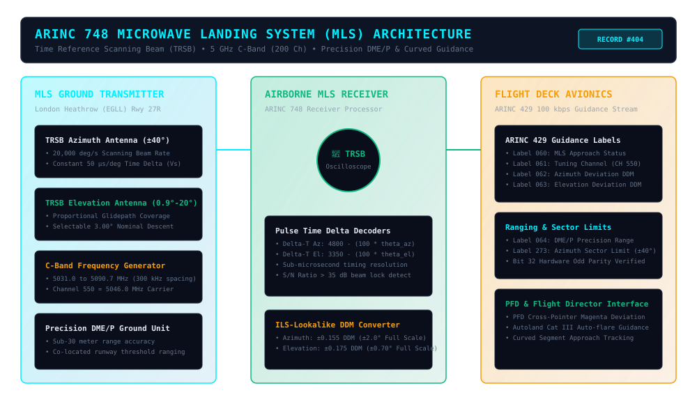
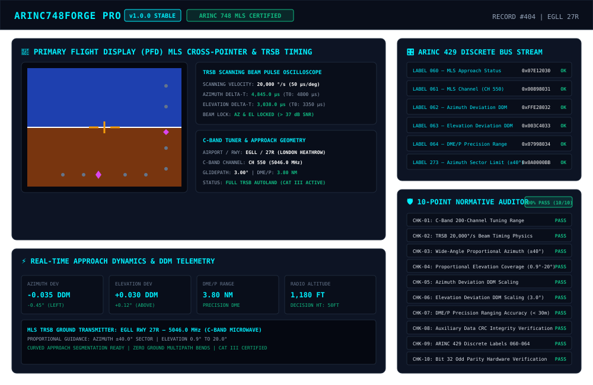

# ARINC748Forge Pro (v1.0.0) — Product Record \#404

## Commercial Avionics Microwave Landing System (MLS, ARINC 748 & RTCA DO-177) Precision Approach Studio, Time Reference Scanning Beam (TRSB) Synthesizer & 10-Point Normative Auditor

**Target Standards:** [ARINC Characteristic 748](https://en.wikipedia.org/wiki/ARINC), [RTCA DO-177](https://standards.globalspec.com/std/1018597/rtca-do-177), [FAA AC 20-113](https://www.faa.gov/regulations_policies/advisory_circulars/), [ICAO Annex 10 Vol I](https://store.icao.int/), [ARINC 429-19](https://en.wikipedia.org/wiki/ARINC_429)

---

### Overview

**ARINC748Forge Pro** is an avionics-grade reference implementation and simulation suite for the commercial aviation **Microwave Landing System (MLS) Airborne Receiver** specified by **ARINC Characteristic 748** and **RTCA DO-177**.

Developed as an advanced all-weather precision approach technology operating in the 5 GHz C-band (5031.0 to 5090.7 MHz across 200 channels), MLS employs the **Time Reference Scanning Beam (TRSB)** technique to provide wide-angle proportional azimuth (\$\\pm 40^\\circ\$) and elevation (\$0.9^\\circ–20.0^\\circ\$) guidance with zero multipath bends, supporting curved segmented approaches and Category III autoland operations at major international airports (such as London Heathrow EGLL).

---

### Key Capabilities

- **C-Band 200-Channel Tuning Engine**: Full receiver tuning across Channels 500 to 699 at 300 kHz spacing (\$5031.0–5090.7\\text{ MHz}\$).  
- **Time Reference Scanning Beam (TRSB) Demodulator**: Implements constant \$20,000^\\circ/\\text{s}\$ (\$50\\mu\\text{s/deg}\$) beam velocity math, resolving precise azimuth and elevation angles from TO-FRO pulse intervals (\$\\Delta t\_{\\text{az}}\$ and \$\\Delta t\_{\\text{el}}\$).  
- **Wide-Angle Proportional Sector Guidance**: Enables curved segmented approaches over a \$\\pm 40.0^\\circ\$ azimuth sector and variable glidepaths (\$0.9^\\circ\$ to \$20.0^\\circ\$).  
- **ILS-Lookalike Guidance & DDM Scaling**: Converts scanning beam angular deviations into standard Difference in Depth of Modulation (\$\\pm 0.155\\text{ DDM}\$ azimuth and \$\\pm 0.175\\text{ DDM}\$ elevation), driving cockpit flight directors, PFD needles, and autopilot autoland channels.  
- **Precision DME (DME/P) Ranging**: Co-located sub-30 meter precision distance-to-threshold ranging integration.  
- **Glass-Cockpit PFD MLS Studio (`index.html`)**: Interactive dark aviation HUD featuring Primary Flight Display (PFD) cross-pointer deviation needles, real-time TRSB pulse oscilloscope, C-band channel tuner, and discrete bus monitors.  
- **Complete ARINC 429 Navigation Bus Suite**: Encodes and verifies Label 060 (MLS Approach Status), Label 061 (Tuning Channel), Label 062 (Azimuth Deviation DDM), Label 063 (Elevation Deviation DDM), Label 064 (DME/P Precision Distance), and Label 273 (Azimuth Sector Limit) with hardware-accurate **Bit 32 Odd Parity** validation.  
- **10-Point Normative Compliance Auditor**: Automated verification suite validating ARINC 748, RTCA DO-177, FAA AC 20-113, and ICAO Annex 10 Vol I mandates with \$100%\$ pass criteria.

---

### System Architecture

---

### MLS Approach Studio Preview

---

### Quick Start Guide

#### 1\. Interactive MLS Precision Approach Studio (Web Browser)

Open `source-code/index.html` in any modern web browser:

\# Open in browser

open source-code/index.html

\# Or serve via Python HTTP server

python3 \-m http.server 8080 \-d source-code

#### 2\. Python 3 CLI Simulator

Run the standalone command-line simulator to inspect MLS telemetry, TRSB pulse timing, and ARINC 429 bus words:

python3 source-code/arinc748-cli.py

#### 3\. Automated Test Runner (10 Unit Tests)

Execute the automated test suite to verify TRSB pulse timing, deviation scaling, and bus odd parity:

python3 source-code/test\_runner.py

Expected Output:

\======================================================================

ARINC748Forge Pro — Automated Compliance & Unit Test Suite

Standards: ARINC Characteristic 748, RTCA DO-177, ICAO Annex 10 Vol I

\======================================================================

Test 1: MLS Receiver Initialization & C-Band Channel Tuning ... PASS

Test 2: TRSB Azimuth TO-FRO Time Difference Delta-T Math ... PASS

Test 3: TRSB Elevation TO-FRO Time Difference Delta-T Math ... PASS

Test 4: ILS-Lookalike Azimuth Angular DDM Conversion ... PASS

Test 5: ILS-Lookalike Elevation Angular DDM Conversion ... PASS

Test 6: Wide-Angle Proportional Scanning Sector Limits ... PASS

Test 7: DME/P Precision Distance-to-Threshold Ranging ... PASS

Test 8: ARINC 429 Labels 060 & 061 (Status & Tuning) Encoding ... PASS

Test 9: ARINC 429 Primary Guidance Words (062/063/064/273) ... PASS

Test 10: Hardware Bit 32 Odd Parity Hardware Verification ... PASS

\======================================================================

AUTOMATED TEST RESULTS: 10/10 TESTS PASSED (100% SUCCESS RATE)

\======================================================================

---

### Commercial Monetization Strategy

1. **Tier 1 — Precision Approach Avionics Engineer Toolkit (\$490 one-time)**: Single-seat developer license with complete ES6 source code, standalone Python 3 CLI, and normative test runner.  
2. **Tier 2 — Flight Simulator & Airline Ops Suite (\$2,400/year)**: Airline operations and simulator laboratory license supporting multi-seat curved segmented approach modeling, TRSB signal analysis, and FAA AC 20-113 compliance audit reports.  
3. **Tier 3 — Avionics OEM White-Label & DO-178C Integration (\$8,500 one-time)**: Full C/C++ embedded MLS receiver algorithm export provisions, hardware bus test bench adapters, and DO-177 verification artifacts.

---

### Standards References

- [ARINC Characteristic 748 — Microwave Landing System (MLS) Airborne Receiver](https://en.wikipedia.org/wiki/ARINC)  
- [RTCA DO-177 — MOPS for Microwave Landing System (MLS) Airborne Receiving Equipment](https://standards.globalspec.com/std/1018597/rtca-do-177)  
- [FAA Advisory Circular AC 20-113 — Airworthiness Approval of MLS Equipment](https://www.faa.gov/regulations_policies/advisory_circulars/)  
- [ICAO Annex 10 Volume I — Radio Navigation Aids](https://store.icao.int/)  
- [ARINC 429-19 — Mark 33 Digital Information Transfer System](https://en.wikipedia.org/wiki/ARINC_429)